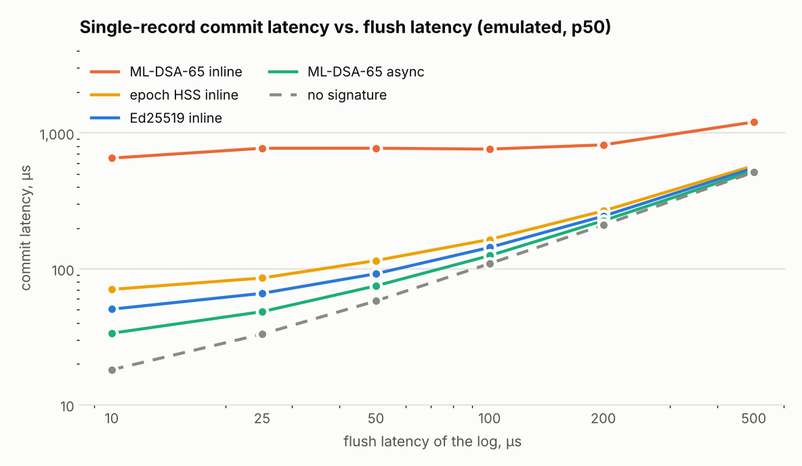
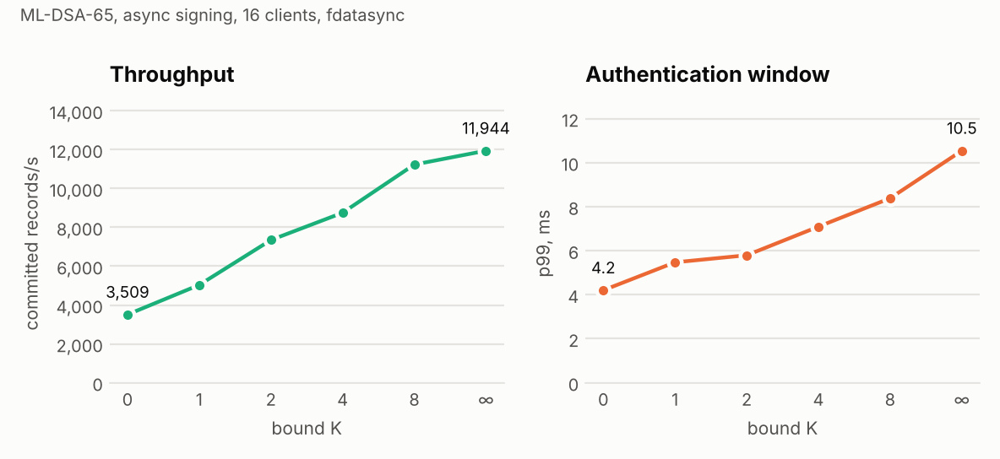

# sealwal

**A tamper-evident write-ahead log with private, erasable records and post-quantum signed group commits.**

`sealwal` is a research prototype built around one question: *can a database
stop trusting the storage under its WAL without paying for it on the commit
path, leaking data through its proofs, or giving up the right to erasure?*

Every group commit is closed by a **seal** that carries the head of a Merkle
history tree over the whole log, chained to the previous seal. Leaves are
salted commitments, not payloads. Anyone with the public key can verify the
log, check that it only grew, or check a single record from a small receipt,
without seeing the other records and without trusting the storage.

```
 DATA DATA DATA SEAL#0 | DATA SEAL#1 | DATA DATA SEAL#2 SIG(#2) | ...
 └─── commit 0 ───┘       └ commit 1 ┘  └─── commit 2 ───┘
 leaf_i  = H(0x00 | lsn | c_i)          c_i = H(tag | salt_i | payload_i)
 SEAL#j  = (j, first_lsn, last_lsn, root of the tree over records 1..last, digest(SEAL#j-1))
```

## Why

Cloud databases keep their WAL more and more on storage they don't control:
log services, their replicas, and object storage for archived segments.
Whoever can write there can rewrite history. Hash chains and Merkle trees fix
that in principle, but three things get in the way:

* **Post-quantum signatures are slow next to a fast flush.** Audit logs live
  for years, so their signatures should survive quantum computers. One
  ML-DSA-65 signature takes about 610 µs here, while a low-latency log service
  flushes in 10-100 µs. Signed inline, the signature sets the commit latency.
* **Merkle receipts leak the neighbours.** An inclusion proof contains the leaf
  of the next record. If leaves are `H(record)` and the record is a balance or
  a diagnosis code, you can brute-force it. With a plain receipt I recovered a
  neighbouring balance (out of 10^6 candidates) in 0.71 s.
* **Immutability vs. erasure.** GDPR wants personal data deletable. Deleting a
  record from a Merkle log changes every hash above it.

## What it does

* **Group commit** with one `write()` and one flush per batch. A record is
  committed once its seal is durable.
* **History-tree seals** (RFC 9162 hashing) with a digest chain bound to the
  header. A signature on seal *j* covers every record and seal up to *j*.
* **Private records.** Each data subject gets a key. The salt is
  `HMAC(k_s, "salt"|lsn)` and the payload is AES-GCM encrypted with the LSN and
  subject as associated data. Receipts and audits only ever see commitments.
* **Erasure by crypto-shredding.** Deleting a subject's key makes its records
  unreadable and unguessable. Every signature, every other receipt and every
  consistency proof still verifies.
* **Keyless audit.** Structure, chain, roots, signatures and append-only can all
  be checked without any subject key.
* **Receipts** for single records, with or without the opening, and
  **consistency proofs** between two seals (the log only grew).
* **Signing off the commit path**: inline, every *k*-th seal, or a background
  signer with a bound *K* on how many committed seals may be unsigned.
* **Epoch-stateful LMS/HSS** (RFC 8554) signatures, about as fast as Ed25519
  and hash-based only. See below for how the state is kept.
* Ed25519, ML-DSA-44/65/87 and a hybrid Ed25519 + ML-DSA-65 mode as well.
* **Crash recovery** (torn tails, uncommitted records, unsigned tail) and
  rollback detection with external anchors.

## Quick start

Needs Python ≥ 3.10, `cryptography` with ML-DSA support (tested with 50.0.1),
and OpenSSL headers for the small C core used by the HSS signer.

```bash
pip install -e .
make -C csrc                # builds sealwal/_lmots.so
python -m pytest -q         # 127 tests

python -m sealwal keygen --alg lms-hss --out key
python -m sealwal demo   --alg lms-hss --key key --log demo.wal -n 1000
python -m sealwal verify demo.wal --pubkey key.pub
python -m sealwal prove  demo.wal --lsn 42 > proof.json
python -m sealwal check  proof.json --pubkey key.pub

python examples/kvstore.py  # private records, crash, erasure, keyless audit
```

As a library:

```python
from sealwal import KeyStore, SealedLog, make_signer, prove, check_proof, verify

signer = make_signer("lms-hss")
keys = KeyStore("subjects.json", create=True)
keys.add_subject(7)                                   # customer 7

log = SealedLog.create("db.wal", signer, keys=keys)
lsn = log.append(b'{"acct":7,"balance":70}', subject=7)
log.commit(); log.close()

receipt = prove("db.wal", lsn, keys=keys)              # opening + audit path
assert check_proof(receipt, signer.public_bytes)

keys.shred(7)                                         # erase customer 7
assert verify("db.wal", signer.public_bytes, keys=keys).ok
```

## Design

**Format.** A header (algorithm, public key), then CRC-framed `DATA`, `SEAL`
and `SIG` frames. CRCs only catch torn writes; the seals do the security work.
A damaged frame counts as a torn tail only if no well-formed frame follows it.
Otherwise recovery refuses to truncate, so tampering can't pass for a crash.
Byte layout in `sealwal/format.py`.

**Seals.** `digest_j = H("sealwal/seal/v2" | j | first | last | root_j | digest_{j-1})`,
with `digest_{-1}` derived from the header. `root_j` covers the whole log, so the
writer only keeps the O(log n) right frontier of the tree.

**Signing modes.**

| mode | commit waits for a signature? | unsigned committed seals |
|---|---|---|
| inline (default) | yes | never |
| `sign_every=k` | 1 in *k* commits | up to *k*−1 |
| `async_sign=True, max_unsigned=K` | only if more than *K* are unsigned | at most *K* |
| `async_sign=True` | no | unbounded (the *authentication window*) |

The background signer always signs the newest seal, so when commits arrive
faster than signatures, one signature covers many seals.

**Epoch-stateful HSS.** LMS keys are trees of one-time keys, and using one twice
breaks security. Normally that means a durable index write per signature. A
WAL already has a natural boundary, recovery, so the key is two-level:

* the top tree has one leaf per **epoch**, and the key file keeps an epoch
  counter that is fsynced *before* an epoch is used;
* the bottom tree of an epoch is derived from the seed, and its index only
  lives in memory;
* every process start (and every full bottom tree) opens a new epoch, and the
  next epoch's tree is built in the background.

A crash wastes the rest of an epoch but never reuses a leaf, and the commit
path never writes state. A file lock keeps two processes on one key file
apart. For a primary and its standbys, `lms.split_keyfile` gives each replica
its own slice of epochs under the same public key, so even a split brain can't
reuse a leaf. The one thing you must not do is restore a key file from a backup.

**Privacy.** The leaf only depends on `c = H(tag | salt | payload)`, and the salt
comes from the subject key. A receipt holder sees salted commitments of the
other records, which tell them nothing. A transfer between two customers is
written as two records in the same commit, one per subject, so each can be
erased on its own.

## Threat model

*In scope:* someone who can read and write the log's storage (a compromised
log node, an operator with bucket access, an archived segment edited at rest)
but holds neither the signing key nor the subject keys. Detected: modified,
inserted, deleted or reordered records; dropped or reordered commits; a log
rebuilt under another key; forks, via consistency proofs; and, **with an
anchor**, rollback.

*Out of scope:* a compromised running engine (it can sign anything); metadata
such as positions, subject ids, sizes and timing; confidentiality of public
records; availability.

*Assumptions:* epoch safety needs a key file that can't be rolled back, and
erasure needs the key store's backups to be shredded too. Erasure can't take
back openings you already handed out in receipts.

## Results

Setup: a shared 2-vCPU VM, ext4, Python 3.13, 256-byte records, three runs per
configuration (median). "Emulated" means the flush is a calibrated busy-wait,
to model a low-latency log service. Numbers on a shared VM are noisy (up to
about 20% between runs), so look at the ratios. Reproduce with
`python bench/bench.py && python bench/extra.py && python bench/plot.py`;
raw data is in `results/`.



**Signing primitives** (p50):

| scheme | sign | verify | signature | public key |
|---|---|---|---|---|
| Ed25519 | 32 µs | 105 µs | 64 B | 32 B |
| ML-DSA-65 | 610 µs | 159 µs | 3,309 B | 1,952 B |
| ML-DSA-87 | 788 µs | 254 µs | 4,627 B | 2,592 B |
| epoch HSS (W4, h=10/10) | 50 µs | 105 µs | 5,076 B | 60 B |

Building the next epoch's tree takes 76 ms, in the background.

**Commit path.** With a 10 µs emulated flush, a one-record commit takes 18 µs
unsigned, 652 µs with inline ML-DSA-65, 71 µs with epoch HSS and 34 µs with
async ML-DSA-65. Group commit with real `fdatasync` and 16 clients:

| configuration | records/s | p99 window |
|---|---|---|
| unsigned | 11,094 | – |
| ML-DSA-65 inline | 4,784 | – |
| epoch HSS inline | 7,248 | – |
| ML-DSA-65 async, *K* = 1 | 5,033 | 5.5 ms |
| ML-DSA-65 async, *K* = 4 | 8,750 | 7.1 ms |
| ML-DSA-65 async, unbounded | 11,944 | 10.5 ms |



**Key-value workload** (YCSB-A-like: 8 threads, 50% reads, 50% updates,
Zipfian keys, `fdatasync`):

| configuration | ops/s | vs. unsigned |
|---|---|---|
| unsigned, public | 10,019 | 100% |
| ML-DSA-65 inline, public | 4,638 | 46% |
| ML-DSA-65 async *K*=1, private | 5,292 | 53% |
| epoch HSS inline, public | 6,771 | 68% |
| epoch HSS inline, private | 6,455 | 64% |

**Privacy and erasure.** In a tight loop at 64 records per commit, private
records cost 23% of throughput (Python; it's one HMAC, one AES-GCM and two
hashes per record). On 100k private records from 10k subjects, a keyless audit
takes 0.56 s and erasing a subject 9.4 ms. Shredding cost is all in the key
store: the simple JSON store here takes 1.07 s at a million subjects.

**Crashes and corruption.** 600 random crash points (truncation plus up to 30
junk bytes) all recovered to exactly the last surviving seal and verified, and
each HSS restart used a new epoch. 600 random single-bit flips before the last
frame were all refused.

**Proofs.** Verifying 100k records takes 0.68 s (ML-DSA-65) / 0.51 s (HSS). A
receipt has 11 sibling hashes; as JSON it's 8.4 KB with ML-DSA-65 and 12 KB with
HSS, most of it the signature.

## Limitations and next steps

* Python prototype on a shared VM; signing and hashing run in native code but
  framing doesn't. Next is a real engine (PostgreSQL, or LeanStore with BtrLog)
  and TPC-C on dedicated hardware.
* One segment file; no segment rotation, archival or key rotation yet.
* The key store is a JSON file; a KMS would make shredding O(1).
* Records are classified as public or private at write time.
* A formal model (Tamarin) of commit, signing, recovery and erasure is in progress.

## Layout

```
sealwal/format.py    on-disk format, seal digests
sealwal/merkle.py    RFC 9162 tree, audit paths, consistency proofs
sealwal/privacy.py   commitments, per-subject keys, AES-GCM, shredding
sealwal/signers.py   Ed25519 / ML-DSA / hybrid / HSS behind one interface
sealwal/lms.py       LMS/HSS (RFC 8554), epoch key file, replica split
csrc/lmots.c         LM-OTS chains and LMS tree build (OpenSSL SHA-256)
sealwal/log.py       writer, signing modes, recovery, GroupCommitter
sealwal/verify.py    verifier, receipts, consistency proofs
examples/kvstore.py  key-value store with private records and erasure
bench/               benchmarks and plots
tests/               pytest suite
```

## References

* RFC 9162, *Certificate Transparency Version 2.0*.
* RFC 8554, *Leighton-Micali Hash-Based Signatures*; NIST SP 800-208.
* NIST FIPS 204, *Module-Lattice-Based Digital Signature Standard*.
* S. Crosby and D. Wallach, *Efficient Data Structures for Tamper-Evident Logging*, USENIX Security 2009.

## License

MIT, see `LICENSE`.
