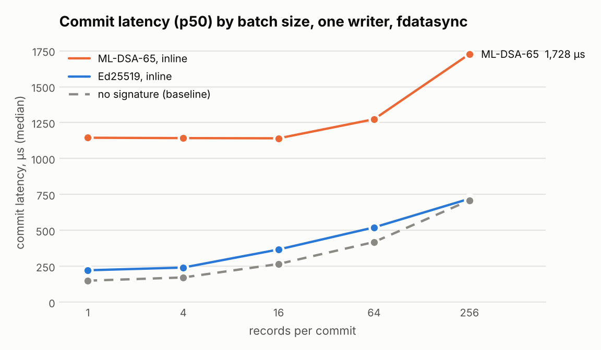
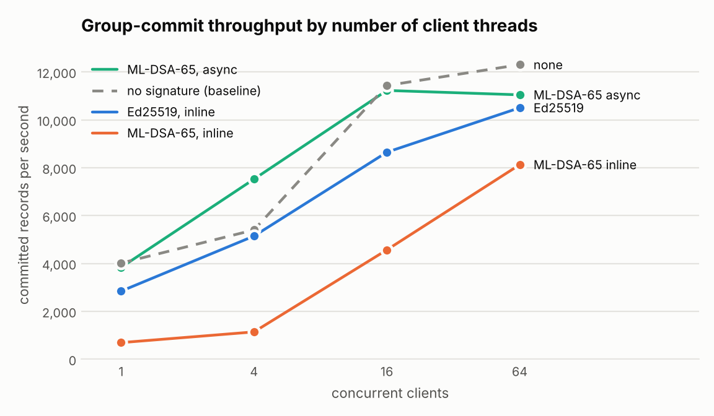

# sealwal

**A tamper-evident write-ahead log with post-quantum signed group commits.**

`sealwal` is a research prototype that asks a simple systems question: *what
does it cost to make a database's write-ahead log tamper-evident with
post-quantum (FIPS 204 ML-DSA) signatures, and how do you keep that cost off
the commit path?*

Each group commit is closed by a **seal**: a Merkle root over the batch's
records, chained to the previous seal and signed. Anyone holding the public key
can verify the whole log, or check a single record with a compact inclusion
proof, without trusting the storage the log lives on.

```
 DATA DATA DATA SEAL#0 | DATA SEAL#1 | DATA DATA SEAL#2 SIG(#2) | ...
 └─── batch 0 ───┘        └ batch 1 ┘   └─── batch 2 ───┘
 SEAL#j = (seal_no, first_lsn, last_lsn, MerkleRoot(batch j), digest(SEAL#j-1), [signature])
```

## Why

Cloud database systems increasingly put their WAL on storage they do not fully
control: remote block storage, dedicated multi-tenant log services, and cheap
object storage for archived log segments. Whoever can write that storage can
silently rewrite history. Some systems already ship tamper evidence for this
(SQL Server / Azure SQL's ledger feature, for example, hash-chains transactions
and stores digests externally). Two things make the question interesting
again:

* **Long retention + quantum.** Audit logs are kept for years. A signature that
  a future quantum computer can forge weakens every integrity claim made about
  the archive, so long-lived logs are a natural place for post-quantum
  signatures.
* **PQ signatures are not free.** On this test machine one ML-DSA-65 signature
  takes about 0.9 ms, while a durable local flush (`fdatasync`) takes about
  0.15 ms. Signed inline, the signature, not the disk, sets the commit latency.

## What it does

* Append-only log with **group commit**: one `write()` + one flush per batch.
* **Seals** with an RFC 9162-style Merkle tree (any batch size) and a digest
  chain that is bound to the header, so batches cannot be modified, dropped,
  reordered or spliced between logs.
* Signatures: `ed25519`, `ml-dsa-44`, `ml-dsa-65`, `ml-dsa-87`, or `none` (baseline).
* Three **signing policies**: sign every seal inline; sign every *k*-th seal;
  or **asynchronous** signing by a background thread, which takes signing off
  the critical path at the cost of a short, measured *authentication window*.
* **Crash recovery**: torn tails and uncommitted records are truncated;
  committed-but-unsigned seals left by a crash are re-signed.
* **Rollback detection** with external anchors (`log.anchor()`).
* **Inclusion proofs** for single records (log2(batch) hashes + one signature).
* A small key-value store example and a benchmark harness.

## Quick start

Requires Python ≥ 3.10 and `cryptography` with ML-DSA support (tested with 50.0.1).

```bash
pip install -e .            # or just: pip install cryptography
python -m pytest -q         # 106 tests

python -m sealwal keygen --alg ml-dsa-65 --out key
python -m sealwal demo   --key key --log demo.wal -n 1000
python -m sealwal verify demo.wal --pubkey key.pub
python -m sealwal prove  demo.wal --lsn 42 > proof.json
python -m sealwal check  proof.json --pubkey key.pub

python examples/kvstore.py  # crash, recover, then detect an offline edit
```

As a library:

```python
from sealwal import SealedLog, GroupCommitter, make_signer, verify

signer = make_signer("ml-dsa-65")
log = SealedLog.create("db.wal", signer, async_sign=True)
gc = GroupCommitter(log)
lsn = gc.submit(b'{"op":"put","k":"alice","v":70}')   # returns once durable
gc.close(); log.close()

report = verify("db.wal", signer.public_bytes)
assert report.ok and report.unauthenticated_seals == 0
```

## Design

**Format.** A header (algorithm, public key) followed by CRC-framed `DATA`,
`SEAL` and `SIG` frames. CRCs only detect torn writes; security comes from the
seals. See `sealwal/format.py` for the byte layout.

**Commit protocol.** `append()` buffers; `commit()` writes the batch and its
seal in one `write()` and flushes. A record is committed when its seal is
durable. Anything after the last seal is an uncommitted transaction and is
discarded on recovery.

**Seal chain.** `digest_j = H("sealwal/seal/v1" | seal_no | first_lsn | last_lsn | root_j | digest_{j-1})`,
with `digest_{-1}` derived from the header. A signature over `digest_j`
therefore authenticates seals `0..j` and every record in them, which is what
makes sign-every-*k* and async signing sound.

**Signing policies.**

| policy | commit waits for signature? | unsigned committed seals |
|---|---|---|
| `sign_every=1` (default) | yes | never |
| `sign_every=k` | 1 in *k* commits | up to *k*−1 |
| `async_sign=True` | no | for one signing time, roughly (the *authentication window*) |

The async signer always signs the *newest* seal digest, so when commits arrive
faster than signatures, one signature covers many seals.

**Verification** (`verify()`) replays the log and checks LSN continuity, batch
boundaries, Merkle roots, the digest chain, and every signature against a
**pinned** public key. The key in the header is attacker-controlled if the file
is, so verifying against it alone is reported as a warning.

## Threat model

*In scope:* an adversary who can read and write the log's storage (a
compromised log node, an operator with bucket access, an archived segment
edited at rest) but does not hold the signing key. Detected: modified, inserted,
deleted or reordered records; dropped or reordered batches; a log rebuilt under
a different key; and, **with an external anchor**, rollback (cutting off the
most recent batches).

*Out of scope:* an adversary holding the signing key (keep it in an HSM or an
enclave); confidentiality (payloads are not encrypted); availability.

*Known windows:* records in seals not yet covered by a signature (async mode,
or `sign_every>1`) are protected against corruption but not yet authenticated.
Without an anchor, a log truncated at a seal boundary is indistinguishable from
a shorter log.

## Results

Setup: a shared 2-vCPU Linux VM, ext4, Python 3.13, 256-byte records,
`fdatasync` on every commit, single runs of 2 s per configuration. Treat
absolute numbers as indicative; the *ratios* are the point. Reproduce with
`python bench/bench.py && python bench/plot.py`. Raw data: `results/*.csv`.



**Batch sweep (one writer).** Median commit latency / throughput / bytes stored per record:

| records per commit | none | Ed25519 | ML-DSA-44 | ML-DSA-65 | ML-DSA-87 |
|---|---|---|---|---|---|
| 1  | 150 µs · 5.8k/s · 372 B | 222 µs · 3.9k/s · 436 B | 773 µs · 1.1k/s · 2.8 KB | 1,145 µs · 0.7k/s · 3.7 KB | 1,315 µs · 0.6k/s · 5.0 KB |
| 64 | 419 µs · 142k/s · 275 B | 521 µs · 111k/s · 276 B | 1,018 µs · 52k/s · 312 B | 1,274 µs · 43k/s · 326 B | 1,608 µs · 34k/s · 347 B |



**Group commit (N client threads, one committer).** Client-observed median latency / throughput:

| clients | none | Ed25519 inline | ML-DSA-65 inline | ML-DSA-65 async | async auth. window p50 / p99 |
|---|---|---|---|---|---|
| 1  | 223 µs · 4.0k/s | 317 µs · 2.8k/s | 1,225 µs · 0.7k/s | 228 µs · 3.8k/s | 2.0 / 7.1 ms |
| 16 | 1,230 µs · 11.4k/s | 1,805 µs · 8.6k/s | 3,086 µs · 4.6k/s | 1,018 µs · 11.2k/s | 2.5 / 9.1 ms |
| 64 | 4,981 µs · 12.3k/s | 5,868 µs · 10.5k/s | 7,336 µs · 8.1k/s | 5,205 µs · 11.0k/s | 4.9 / 15.8 ms |

**Verification and proofs.** Verifying a 100k-record log (batches of 64)
takes 0.27 s without signatures, 0.52 s with Ed25519 and 0.57 s with ML-DSA-65.
An inclusion proof carries 6 audit-path hashes; as JSON it is about 1.3 KB with
Ed25519 and about 7.9 KB with ML-DSA-65, most of that the hex-encoded signature.

**What the numbers say.**

1. **Signed inline, ML-DSA dominates commit latency.** One-record commits go
   from 150 µs to 1.15 ms with ML-DSA-65 (about 7.6×). Ed25519 adds only about 70 µs.
2. **Batching amortizes throughput and space, not latency.** At 64 records per
   commit, ML-DSA-65 costs +19 % bytes per record, but every commit still pays
   about 0.9 ms of signing.
3. **Async signing recovers baseline performance.** Latency and throughput
   return to the level of the unsigned baseline. (At 4 clients the async run
   even beat the baseline run, which mostly shows how noisy a shared 2-vCPU
   VM is; repeated runs on dedicated hardware are a to-do.) The price is
   an authentication window of about 2 ms median (7 to 16 ms p99 under load)
   in which committed seals are not yet signed.

## Limitations and next steps

* Python prototype: a Rust or C++ implementation would show the true
  CPU cost of hashing and framing; signing itself already runs in native code.
* Single segment file; no segment rotation, archival or key rotation yet.
* Next: run against a low-latency remote log, where the flush costs tens of
  µs and inline signing hurts even more; bound the authentication window
  explicitly (sign when *t* ms or *k* seals have passed); evaluate stateful
  hash-based signatures (LMS/XMSS), whose required state counter maps
  naturally onto a log's monotonic LSN; attest table-format snapshots
  (Apache Iceberg / Delta) with the same seal construction.

## Layout

```
sealwal/format.py    on-disk format, seal digests
sealwal/merkle.py    RFC 9162-style Merkle tree and audit paths
sealwal/signers.py   Ed25519 / ML-DSA / none behind one interface
sealwal/log.py       SealedLog writer, signing policies, recovery, GroupCommitter
sealwal/verify.py    verifier, inclusion proofs
sealwal/__main__.py  CLI
examples/kvstore.py  key-value store on top of sealwal
bench/               benchmark harness and plotting
tests/               pytest suite (tamper, rollback, torn tail, proofs, concurrency)
```

## References

* RFC 9162, *Certificate Transparency Version 2.0* (Merkle tree and audit paths).
* NIST FIPS 204, *Module-Lattice-Based Digital Signature Standard* (ML-DSA).
* NIST SP 800-208, *Recommendation for Stateful Hash-Based Signature Schemes*.

## License

MIT, see `LICENSE`.
